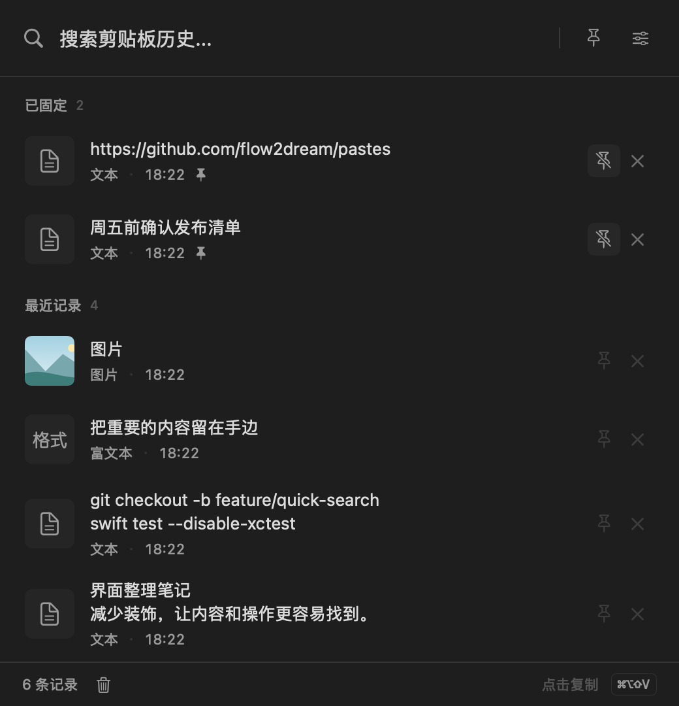

# Pastes

A macOS clipboard history manager. View, search, pin, and manage your clipboard records with one click.

[中文文档](README_CN.md)

## Features

- **Clipboard History** — Automatically records all copied text and images
- **Rich Text Support** — Preserves original formatting (Word, code, etc.)
- **Global Hotkey** — Default `⌘⇧V` to summon from anywhere, fully customizable
- **One-Click Paste** — Click an item to copy and paste directly at cursor position
- **Pin Favorites** — Pin important items to the top, unaffected by cleanup
- **Search** — Quickly search through clipboard history
- **History Limit** — Configurable max items, auto-removes oldest entries
- **Launch at Login** — Optional auto-start on macOS login
- **Bilingual UI** — Chinese and English supported
- **Menu Bar App** — Lives in the menu bar, no Dock icon

## Installation

### Download DMG

Download `Pastes-1.1.0-arm64.dmg` from the [v1.1.0 Release](https://github.com/flow2dream/pastes/releases/tag/v1.1.0), then drag `Pastes.app` into Applications. The package requires Apple Silicon and macOS 26.0 or later.

> This package is signed with a development certificate and is not Developer ID notarized. First launch may require explicit approval in System Settings → Privacy & Security.

#### Upgrading from an Older Version

v1.1.0 replaces SwiftData storage with SQLite. **Existing history and pinned records are not automatically migrated; the new history starts empty.** The legacy database is preserved and is neither opened nor deleted. Back up and keep the older application if you need its existing history. Production data is stored at `~/Library/Application Support/com.pastes.app.pastes/clipboard.sqlite`.



### Build from Source

Full Xcode is optional. Install macOS Command Line Tools with Swift 6.2 or later:

```bash
# Skip this if Command Line Tools are already installed
xcode-select --install

git clone https://github.com/flow2dream/pastes.git
cd pastes
make run
```

Open the project folder in Cursor, VS Code, or another editor.

- `make build`: compile and package the Debug development app.
- `make run`: build and open the development app.
- `make test`: run all regression tests.
- `make release`: compile and package the Release development app.
- `make distribution`: create the production `build/Distribution/Pastes.app`.
- `make package`: create the production DMG and `SHA256SUMS` in `build/releases/v<version>/`.

The first build downloads a pinned Sparkle dependency through Swift Package Manager. No database server, Apple developer certificate, or environment secrets are needed. Packaging uses the system `iconutil` and ad hoc code signing.

If a valid development signing certificate is already available, place its 40-character certificate fingerprint in `.pastes-signing-identity` at the repository root, or set `PASTES_SIGN_IDENTITY` (which takes precedence). The local file is ignored by Git; ad hoc remains the default. Reusing a certificate preserves signing identity across rebuilds. Automatic paste still requires system Accessibility authorization; Settings shows the permission detected by the application.

The default output is `build/Debug/Pastes Dev.app`. Its default shortcut is **`⌘⌥⇧V`**. It runs in the menu bar without a Dock icon. Enable Accessibility for this development app in System Settings to use automatic paste.

Development builds use bundle ID `com.pastes.app.pastes.dev` and store history at `~/Library/Application Support/com.pastes.app.pastes.dev/clipboard.sqlite`. Storage now uses system SQLite instead of SwiftData, preserving text, images, rich text, and pinned records across restarts. **Legacy SwiftData history is not automatically imported; its files are not opened or deleted.** Automatic updates are disabled in development builds to prevent the existing release feed from replacing them.

The `.xcodeproj` remains available for optional Xcode use. The commands above do not require `xcodebuild` or Xcode preview macros.

### Build a Development DMG

```bash
make release

mkdir -p dmg_staging
cp -R "build/Release/Pastes Dev.app" dmg_staging/
ln -s /Applications dmg_staging/Applications
hdiutil create -volname "Pastes Dev" -srcfolder dmg_staging -ov -format UDZO Pastes-Dev.dmg

rm -rf dmg_staging
```

`Pastes-Dev.dmg` is for local development installation. It is not Developer ID signed or notarized.

### Validate a Production Update Before Publishing

Validate an existing production DMG against the appcast offline, without installing or launching its application:

```bash
xcrun swift scripts/validate-update.swift appcast.xml /path/to/Pastes.dmg
```

This checks archive length, Ed25519 and application code signatures, bundle ID, minimum system version, and version metadata. `sparkle:version` must match the archive application's `CFBundleVersion` (build number), and `sparkle:shortVersionString` must match `CFBundleShortVersionString` (display version). Development DMGs are rejected from the production feed. Production applications initialize Sparkle at launch; development updates remain disabled.

## Permissions

- **System control permission** — Required for automatic paste (simulates Cmd+V). Production builds request permission at launch. Development builds show an inline notice when permission is missing and request it only through the explicit Settings button, at most once per process. The app's Settings shows the detected event-posting permission.

If the system toggle is on but automatic paste is still unavailable, check the detected status in the app's Settings. Authorization for an older ad hoc build may not match the current stable signature: quit the development app, remove only its old `Pastes Dev.app` permission entry, add the current `build/Debug/Pastes Dev.app`, enable it, and restart. macOS may require authentication. Focus the destination text field before opening clipboard history. Without permission, content is still copied and the panel explains that it can be pasted manually with `⌘V`.

## Usage

| Action | Description |
|--------|-------------|
| `⌘⇧V` | Show/hide clipboard panel (global hotkey) |
| Click item | Copy and paste to current focus |
| Pin button | Pin/unpin an item |
| × button | Delete an item |
| Left-click menu bar icon | Show panel |
| Right-click menu bar icon | Settings / Quit |

## System Requirements

- macOS 26.0 or later
- Source development: Command Line Tools with Swift 6.2 or later, plus network access for the first build

## License

MIT License
