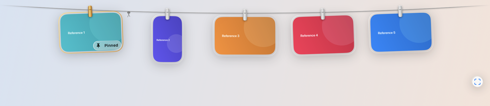
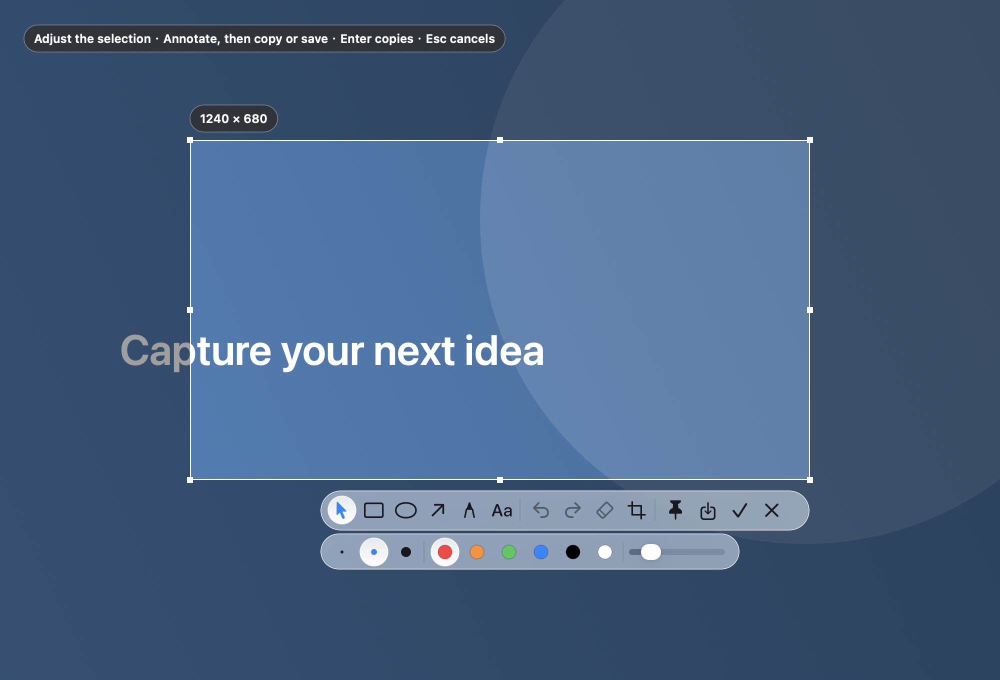
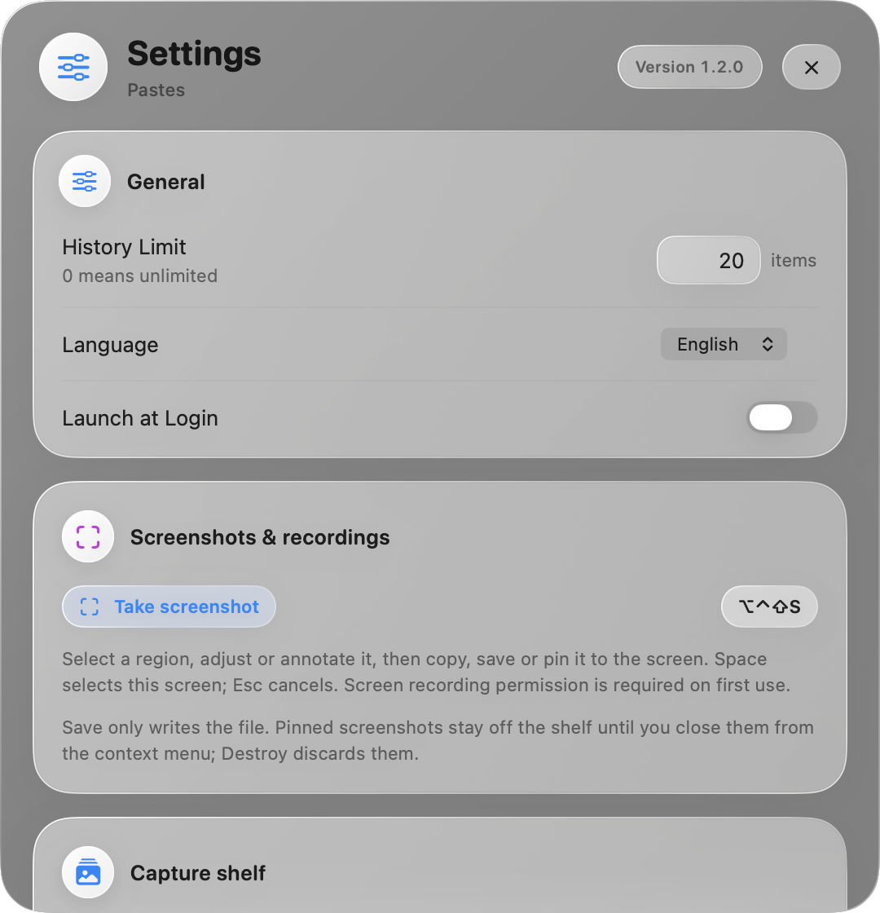

# Pastes

Clipboard history, a capture shelf, and screenshot annotation for macOS. Keep useful text close, hang reference images above your workspace, and pin screenshots on top of other apps.

[中文文档](README_CN.md) · [Download v1.2.0](https://github.com/flow2dream/pastes/releases/tag/v1.2.0) · [Release notes](docs/RELEASE-v1.2.0.md) · [Report an issue](https://github.com/flow2dream/pastes/issues)

## Features

- **Clipboard history:** search copied text and images, preserve RTF formatting, pin favorites, and paste a record into the previously active app.
- **Capture shelf:** organize images and imported videos along the top of the screen, with hover previews, drag and drop, pinning, batch removal, and undo.
- **Built-in screenshots:** select a region, adjust its edges, annotate it, then choose Copy & hang, Save as, or Pin to screen.
- **Floating references:** drag an image from anywhere, click to select it, and use native trackpad pinch gestures to resize the whole image. Close returns it to the shelf; Destroy discards it.
- **Image and video editing:** draw shapes, arrows, freehand strokes, and text; save an edited copy or overwrite the shelf image. Imported recordings support playback and native AVKit trimming.
- **Glass interface:** rounded frosted surfaces, fine highlights, light and dark appearances, and system Reduce Transparency and Reduce Motion support.
- **Menu bar utility:** customizable global shortcuts, optional launch at login, Chinese and English interfaces, and no Dock icon.

### Preview

The screenshots below use sample content.







## Requirements

- macOS **26.0 or later**.
- **Apple Silicon (arm64)** for the downloadable DMG. An Intel application is not included in this release.
- To build from source: Command Line Tools with **Swift 6.2 or later**, plus internet access for the first dependency download. Full Xcode is optional.

## Installation

1. Download **`Pastes-1.2.0-arm64.dmg`** from the [v1.2.0 release](https://github.com/flow2dream/pastes/releases/tag/v1.2.0).
2. Quit any older Pastes process, open the DMG, and drag **Pastes.app** into **Applications**.
3. Launch Pastes. Its icon appears in the menu bar.
4. Allow automatic paste or screen capture when you use those features; see [Permissions](#permissions).

The distributed app is signed with a development certificate and is **not Developer ID notarized**. If macOS blocks its first launch, use **System Settings → Privacy & Security → Open Anyway** when available, then follow the system prompts.

Download `SHA256SUMS` alongside the DMG to verify its integrity. Run this in the folder containing both files:

```bash
shasum -a 256 --check SHA256SUMS
```

### Upgrading

- **From v1.1.0:** the production application continues using the same SQLite history and preferences. Back up the application data directory before replacing the app.
- **From v1.0.x or earlier:** history and pinned records from the legacy SwiftData database are **not automatically migrated**. The new history starts empty; legacy files are neither opened nor deleted. Keep the older app and a backup if you need its records.
- **From a development build:** Pastes Dev has a separate application identity and data directory. Its history, shelf, permissions, and shortcut settings are not automatically transferred to production.

Production builds check for updates through Sparkle; installing an update requires user confirmation. Development builds have updates disabled.

## Quick start

1. Copy some text, then press **⌘⇧V** to open clipboard history. Search or click a record to paste it into the previously focused app.
2. Right-click the menu bar icon and open **Settings**. Enable **Capture shelf** to collect images on the shelf.
3. Press **⌃⌥T** to show or hide the shelf. Hovering at the top screen edge does not open it.
4. Press **⌃⌥S** to take a screenshot. Select a region, make any annotations, and explicitly choose what to do with the result.

These are production defaults. All three global shortcuts are customizable in Settings; development defaults are listed under [Shortcuts](#shortcuts).

## Clipboard history

Left-click the menu bar icon or use the history shortcut to show the panel. Right-click the icon for screenshot, shelf, Settings, and Quit actions.

- Search records by their text content.
- Click a record to copy it and paste into the app that was active before opening the panel. Focus the destination input field first.
- Use the pin button to keep an important record at the top, or the × button to delete it.
- Set the history limit in Settings. The default is **20**; **0 means unlimited**. Pins count toward the total, but automatic cleanup removes only unpinned records.
- Keep the panel open with its panel-pin control when needed.

RTF is retained when supplied by the source app; whether formatting is used on paste also depends on the destination. Finder image copies and standard PNG/TIFF clipboard payloads are supported. Non-image file thumbnails are not treated as copied images.

When automatic paste permission is unavailable, the content is still copied, and the panel shows that you can paste manually with **⌘V**.

## Capture shelf

Enable **Settings → Capture shelf → Enable capture shelf**. It starts disabled. Open it with its shortcut, the menu bar action, or the Settings button.

The shelf stays open while you use its images and controls, and hides when the pointer moves away or you switch apps or Spaces. It does not use top-edge hover activation. A new image can briefly reveal the shelf to show its arrival animation.

### Add and browse media

- Copy an image with **Collect copied images** enabled.
- Use the built-in screenshot tool and choose **Copy & hang**.
- Drag image or video files onto the shelf, or choose **Import files…** in Settings.
- Use Finder's **Add to Pastes Capture Shelf** service to import and pin files. macOS may require enabling the service first.
- Optionally enable **Watch system screenshot folder**. It imports new files marked as system screenshots after watching begins; it does not bulk-import existing desktop images or change the system screenshot destination.

Hover over a photo for about **0.5 seconds** to preview it below the shelf. Move away to dismiss it. Open menus and windows covering the shelf prevent previews of the pictures underneath.

Click a card to copy it, hold to open editing, or double-click to open it in the default application. Overflow navigation and scrolling let you reach older items; the screen width does not impose an eight-image storage limit.

### Organize, share, and remove

Right-click a card to copy, float, edit, open, save, pin, or remove it. Pinned shelf items have a gold clip, gold outline, and persistent pin badge.

Removal offers three actions: **Remove this image**, **Remove all images to the left**, and **Remove all images to the right**. Side removal follows the displayed order and includes pinned items. A batch can be undone together with **⌘Z**. Click a card before using **Delete**, **⌘Z**, or **Esc**.

Drag a card into another app to share a disposable copy. A successful Finder move of that copy removes the shelf entry while retaining the managed media for undo. Trashing a dragged copy does not expose the managed library file as the deletion source.

### Retention and disk space

Choose either:

- **Fit screen:** calculate capacity from the current display width. A few pictures stay grouped in the center; a full row fills the screen. Pins occupy slots, and excess pins remain available by scrolling.
- **Set count:** enter a positive integer and click **Apply**. The default is **20**. Pinned items are exempt from this limit.

Images and videos share the shelf limit. Overflow removes the oldest unpinned entries from the visible shelf. Lowering the limit applies immediately; increasing it does not restore previously removed entries.

Removing an entry retains its managed file for undo. **Purge removed files…** permanently clears those removed library copies. It does not delete external source files or clipboard history. Shelf removal and clipboard-history deletion are independent.

**Hide images in clipboard history** is on by default while the shelf is enabled. It only filters the history view; turning it off, or disabling the shelf, shows those records again.

### Arrival and take-down animations

New images travel from their known source rectangle to the shelf. Built-in screenshots use the exact selected region; shelf copies use the card position. External copies use image bounds exposed through macOS Accessibility. When those bounds are unavailable, the image fades in instead of flying from the pointer. Support varies by source app.

Choosing **Float as reference** lifts an image off its card into a floating window. It leaves the shelf and does not occupy a retention slot while floating. Closing the floating image hangs it back. Reduce Motion uses simpler transitions.

## Built-in screenshots

Start with **⌃⌥S**, **Take screenshot** in the menu bar or Settings, or the shelf's viewfinder button. No external screenshot application is required.

1. Drag to select a region. Use the eight edge and corner handles to resize it, or drag inside to move it. **Space** selects the current display.
2. Add rectangles, ellipses, arrows, freehand strokes, or text. Select annotations to move or resize them, choose colors and stroke widths, and undo or redo changes.
3. Hover over a toolbar button for about **0.5 seconds** to see its function.
4. Choose **Copy & hang**, **Save as**, or **Pin to screen**, as described below.

- **Copy & hang** — **Enter** or **⌘C** copies the result, adds it to clipboard history and the shelf, and plays the arrival animation.
- **Save as** — **⌘S** writes a PNG to your chosen location. It does not add the capture to the shelf or history, or change the clipboard. Cancelling the save dialog returns to editing.
- **Pin to screen** — keeps the image floating above other apps without adding it to the shelf yet.

Press **Esc** or right-click the selection surface to cancel. The result is not committed merely by finishing the selection.

Any connected display can be selected; a region stays within the display where selection began. PNG output preserves that display's pixel scale. Captures exclude the selection overlay and toolbar. Temporary full-display frames remain in memory; only a confirmed selection is saved or imported.

Pastes leaves system screenshot destinations and thumbnail settings unchanged. Pending recovery records from older versions are used only to restore settings still owned by that version; later changes by the user or another app take precedence.

## Floating images and editing

Pin a new screenshot, or choose **Float as reference** on a shelf image.

- Drag from anywhere on the image to move it.
- Click to select it. The blue glow becomes stronger when selected; unselected images retain a blue outline with transparent surroundings.
- With the pointer over the selected image, **pinch or spread two fingers on the trackpad** to scale the entire image. A temporary percentage indicator shows its scale: **100%** is its initial floating size, with an upper limit of **400%**. Normal scrolling does not resize it.
- Right-click for **Edit…**, **Copy image**, **Close**, and **Destroy**.

**Close** hangs the latest edited image onto the shelf from its current position without changing the clipboard. **Destroy** discards the floating image; if it came from the shelf, its shelf entry is removed. A failed Close retains the floating window so you can retry.

New screenshots pinned directly to the screen remain temporary until saved, copied, or closed back to the shelf. Save or close them back before quitting if you need to keep them; quitting closes floating windows without hanging them back.

Editing a floating image reuses the screenshot selection and annotation interface. Shelf image editing additionally offers **Save Copy** (**⌘⇧S**), which creates a new library entry, or **Overwrite Original** (**⌘S**). Overwrite updates the managed shelf image and retains its pin state; the external file originally imported is unchanged. Failed saves keep edits available.

Imported videos support thumbnails, playback, floating playback, and native AVKit trimming. A trimmed recording is saved as a new entry. Pastes does not include a built-in video recorder.

## Settings and shortcuts

Settings covers history retention, interface language, launch at login, all three global shortcuts, screenshot actions, shelf collection and retention, permissions, and updates. Drag its glass header to move the window; use its close button or **⌘W** to close it.

### Shortcuts

Production defaults:

- **⌘⇧V** — show or hide clipboard history.
- **⌃⌥T** — show or hide the capture shelf.
- **⌃⌥S** — begin screenshot selection.

Development defaults:

- **⌘⌥⇧V** — clipboard history.
- **⌃⌥⇧T** — capture shelf.
- **⌃⌥⇧S** — screenshot selection.

Click the corresponding shortcut control in Settings and press a modifier combination or function key. **Esc** cancels recording. Existing app shortcuts are suspended while recording; an unavailable or conflicting combination shows an error and keeps the old binding. Function keys F1–F20 are supported; some keyboards require Fn.

Local editing shortcuts include **⌘Z** to undo and **⌘⇧Z** to redo. Screenshot confirmation uses Enter/⌘C, saving uses ⌘S, and Esc cancels.

## Permissions

- **Accessibility / system control:** used to send the paste shortcut to another app. Accessibility image bounds can also improve external-copy animations. Settings displays the actual event-posting permission detected by Pastes.
- **Screen & System Audio Recording:** required by macOS for built-in screenshots. It is requested when the tool is used; refusal does not save a capture or change the clipboard.
- **Login Items:** macOS may require approval when launch at login is enabled. Settings shows pending approval and provides a link to the system page.

Production and development apps have separate identities and may need separate authorization. macOS can require restarting the app after changing a permission.

## Data and privacy

Pastes stores clipboard history and media locally. It has no account or cloud-sync service and does not upload your clipboard or screenshots. Production update checks contact the GitHub-hosted Sparkle feed and download release assets when requested.

Production data lives under:

```text
~/Library/Application Support/com.pastes.app.pastes/
├── clipboard.sqlite        # Clipboard history
└── CaptureLibrary/         # Managed media and library manifest
```

Development data uses `com.pastes.app.pastes.dev` in the same parent directory. Preferences are stored in each app's own macOS defaults domain. Files in an older capture inbox are preserved.

Quit the app before backing up its data directory, including any SQLite companion files. History and media are not encrypted by Pastes. The clipboard monitor skips known concealed, transient, and password-manager markers, but this depends on the source app supplying those markers; it is not a general sensitive-content filter.

## Build from source

```bash
# Skip this if Command Line Tools are installed.
xcode-select --install

git clone https://github.com/flow2dream/pastes.git
cd pastes
make run
```

Swift Package Manager downloads the pinned **Sparkle 2.10.1** dependency on the first build. SQLite and the other frameworks come from macOS. You can use Xcode, VS Code, Cursor, or another editor; the command-line workflow does not require full Xcode.

- `make build` — build and package `build/Debug/Pastes Dev.app`.
- `make run` — build and restart this checkout's development app.
- `make test` — run the Swift Testing regression suite.
- `make release` — build the optimized development app at `build/Release/Pastes Dev.app`.
- `make distribution` — build the production app at `build/Distribution/Pastes.app`.
- `make package` — build the production DMG and `SHA256SUMS` under `build/releases/v<version>/`.

Development builds use a DEV icon badge, a hammer menu bar icon, separate storage and shortcuts, and disabled updates. Building does not install over an app in Applications.

Local builds use ad hoc signing unless configured otherwise. To reuse an available signing certificate, put its 40-character SHA-1 fingerprint in the Git-ignored `.pastes-signing-identity` file, or set `PASTES_SIGN_IDENTITY`; the environment variable takes precedence. Certificates are not required to build, and these scripts do not notarize the application.

### Release validation

Before publishing a production update, validate its DMG against the matching appcast entry:

```bash
xcrun swift scripts/validate-update.swift \
  appcast.xml build/releases/v1.2.0/Pastes-1.2.0-arm64.dmg
```

The validator checks archive length, Ed25519 update signature, application code signature, production bundle identity, minimum system version, and version metadata without installing or launching the packaged app. `sparkle:version` must equal `CFBundleVersion`; `sparkle:shortVersionString` must equal `CFBundleShortVersionString`. A development application is rejected from the production feed.

## Troubleshooting

**The shortcut opens history, but nothing is pasted.** Focus the destination input first and check automatic paste permission in Settings. Without permission, paste the copied result manually with ⌘V. After rebuilding with a different signing identity, remove the obsolete permission entry and authorize the current app through macOS settings.

**A shortcut cannot be assigned.** Choose another combination if macOS or another app owns it. Pastes keeps the previous working binding when registration fails. Use the defaults above to distinguish production from development.

**The shelf does not open at the top edge.** This is intentional. Enable it in Settings and use its shortcut or Show shelf action.

**An external image fades in instead of flying from its original position.** The source application may not expose image bounds through Accessibility. The fallback is a fade. Built-in screenshots retain their exact selected origin.

**A floating image will not zoom.** Click it to select it, keep the pointer over the image, and use a two-finger pinch or spread. Two fingers sliding in the same direction is scrolling and does not zoom.

**Removed images still use disk space.** Removal preserves managed files for undo. Use Purge removed files in Settings when you no longer need recovery. Deleting clipboard history does not clear independent shelf media.

**A screenshot permission change has no effect.** Confirm that the currently running app is authorized under Screen & System Audio Recording, then quit and reopen it if macOS requests that.

For other problems, [open an issue](https://github.com/flow2dream/pastes/issues) with the app version, macOS version, reproduction steps, and expected behavior. Remove private clipboard content from any attached screenshots or logs.

## Contributing and credits

Bug reports and focused pull requests are welcome. Describe the user-visible change, run the relevant tests, and distinguish production builds from Pastes Dev when reporting behavior.

- [Tendedero](https://github.com/alejandrobujan/tendedero), by Alejandro Buján, inspired and supplied adapted clothesline, animation, and native media interaction approaches under the MIT license. Pastes uses its own name, icon, and interface. See [third-party notices](THIRD_PARTY_NOTICES.md).
- [Sparkle](https://github.com/sparkle-project/Sparkle) provides application updates under the MIT license; its license is included in packaged apps.
- Built with Swift, SwiftUI, AppKit, ScreenCaptureKit, AVKit, and system SQLite.

Pastes is released under the [MIT License](LICENSE).
