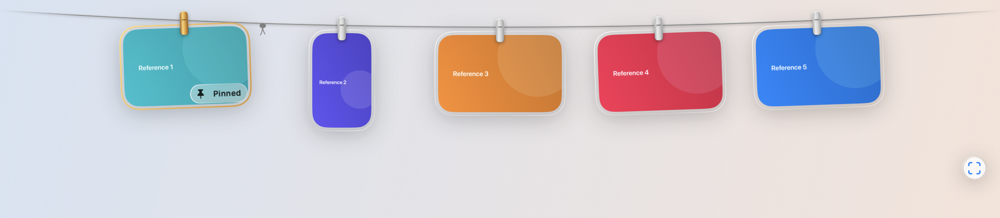
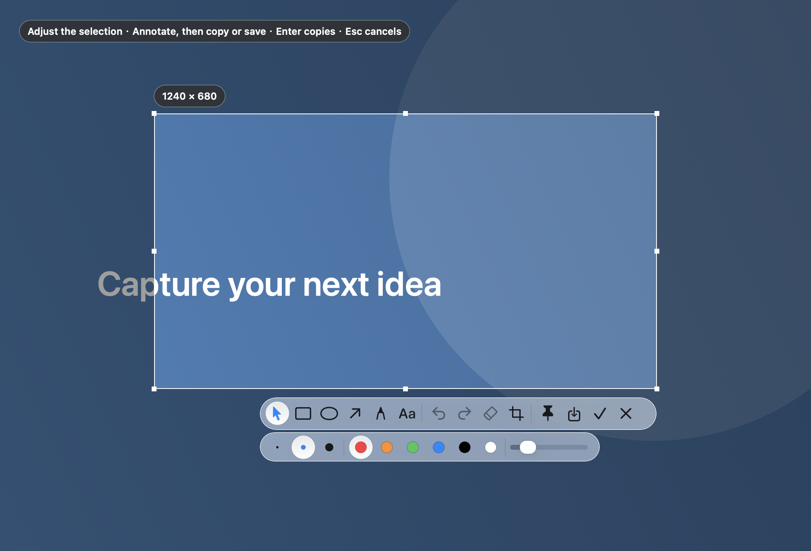
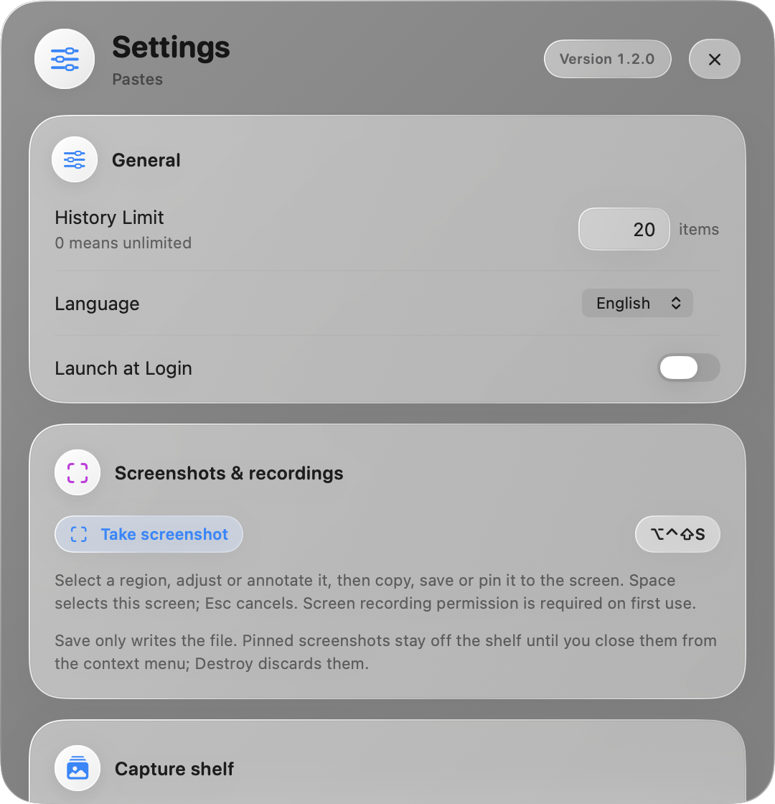

# Pastes

把常用文字留在剪贴板历史里，把图片挂到屏幕顶部，需要参考时再取下来。

Pastes 是一款 macOS 菜单栏工具，将剪贴板历史、图片架、截图标注和悬浮参考图片放在同一个应用中。界面采用清透磨砂玻璃、圆角卡片和细高光，支持浅色、深色外观与系统辅助功能设置。

[English](README.md) · [下载 1.2.0](https://github.com/flow2dream/pastes/releases/tag/v1.2.0) · [更新说明](docs/RELEASE-v1.2.0.md) · [反馈问题](https://github.com/flow2dream/pastes/issues)

## 功能概览

- **剪贴板历史**：记录文字、RTF 富文本和图片，支持搜索、固定、删除及数量限制；点击记录可复制并粘贴到目标应用。
- **顶部图片架**：通过快捷键显示，集中管理复制的图片、截图和导入的视频；支持悬停预览、拖放、左右批量移除及撤销。
- **内置截图**：多屏框选、调整选区、绘制形状和箭头、添加文字，再选择复制并挂上、另存文件或固定到屏幕。
- **悬浮参考**：将图片留在其他窗口上方，任意位置拖动，单击选中后用触控板双指捏合缩放，并查看缩放百分比。
- **图片与视频编辑**：图片可另存副本或覆盖媒体库中的原图；视频可播放、悬浮播放并裁剪为新文件。
- **可调设置**：三个全局快捷键均可自定义，图片架支持自适应容量或指定保留数量，支持登录时启动和中英双语。
- **本地保存**：历史使用系统 SQLite，图片架文件存放在应用专用目录，不需要账户或云服务。

## 界面预览

图片架：



截图与标注：



设置：



## 系统要求

- **运行**：macOS 26.0 或更高版本。
- **发行安装包**：Apple Silicon（arm64）。目前不提供 Intel 安装包。
- **源码构建**：Swift 6.2 或更高版本的 macOS Command Line Tools；首次构建需联网下载 Swift Package Manager 依赖。

## 安装与升级

1. 前往 [Pastes 1.2.0 Release](https://github.com/flow2dream/pastes/releases/tag/v1.2.0)，下载 `Pastes-1.2.0-arm64.dmg`。
2. 打开镜像，将 `Pastes.app` 拖入「应用程序」。更新已有应用前，先退出旧进程。
3. 启动 Pastes。应用常驻菜单栏，不显示 Dock 图标；左键打开剪贴板，右键可截图、打开图片架、进入设置或退出。
4. 根据需要授予自动粘贴和截图权限，详见[权限说明](#权限说明)。

发行包使用开发证书签名，尚未进行 Developer ID 公证。首次运行可能需要到「系统设置 → 隐私与安全性」明确允许运行。仅从本仓库的 Release 下载。

可同时下载 `SHA256SUMS`，在两个文件所在目录核对完整性：

```bash
shasum -a 256 --check SHA256SUMS
```

**升级数据说明：**

- 从 **1.1.0** 升级：正式版继续使用同一 SQLite 数据目录，已有文字、图片和固定历史可保留。
- 从 **1.0.x 或更早版本** 升级：旧版 SwiftData 历史和固定记录不会自动迁移。新历史从空列表开始，旧数据库不会被读取或删除；需要继续查看旧历史时，请先备份并保留旧版应用。
- **Pastes Dev 与正式版相互隔离**：安装正式版不会自动导入开发版历史、图片架文件或快捷键设置。

正式版通过 Sparkle 检查更新，安装更新需要用户确认。开发版关闭自动更新。

## 快速开始

1. 复制一段文字，按 `⌘⇧V` 打开历史，搜索并点击需要的记录。自动粘贴前，先将光标放在目标输入框。
2. 在设置中开启「启用顶部截图架」，复制图片后按 `⌃⌥T` 查看图片架。
3. 按 `⌃⌥S` 开始框选截图；选区完成后可以继续调整和标注，最后决定复制、另存还是固定。
4. 右键架上的图片选择「悬浮参考」，可将它取下作为屏幕参考；右键悬浮图选择「关闭」即可挂回。

以上是正式版默认快捷键，均可在设置中修改。开发版默认值见[快捷键](#快捷键)。

## 剪贴板历史

Pastes 运行时记录支持的文字与图片内容。富文本保存 RTF 数据，粘贴时的实际格式取决于目标应用。Finder 中复制的图片文件也可识别为图片；普通文件不会被缩略图误收为图片记录。

- 点击记录：复制，并尝试粘贴到唤出面板前的目标应用。
- 输入搜索词：按内容筛选历史。
- 点击图钉：固定或取消固定记录。
- 删除记录或清除未固定项：管理历史内容，固定项受保留保护。
- 设置「历史记录上限」：自动清理较早的未固定项；`0` 表示不限。固定项计入总条数，但不会因数量上限而自动删除。
- 固定历史面板：需要连续操作时，可让面板保持打开。

未获得系统控制权限时，点击仍会复制内容，并提示可手动按 `⌘V` 粘贴。

## 图片架

### 显示与收起

图片架默认关闭，在设置中手动启用。按 `⌃⌥T` 显示或收起，也可使用菜单栏菜单或设置中的「显示截图架」。**鼠标移到屏幕顶部不会打开图片架**，不会占用其他软件的顶部菜单操作。

图片架展开后，鼠标离开会自动收起；切换软件或桌面时隐藏。复制或导入新图片、关闭悬浮图挂回时，图片架会短暂展开并播放挂入动画。

### 收集与导入

- 开启「收集复制的图片」，将复制的图片同时收集到架上。
- 可选「监听系统截图目录」，只导入开始监听后新增、带系统截图标记的图片；不会扫描导入桌面上已有的普通图片。
- 将图片或视频拖入图片架，或在设置中选择「导入文件…」。
- Finder「服务」提供 **Add to Pastes Capture Shelf**，导入后作为固定项保留。服务是否显示由 macOS 管理，必要时在系统设置中启用。

Pastes 不接管系统截图快捷键、不改变系统截图保存位置，也不关闭系统截图缩略图。若早期开发版留下配置恢复记录，启动时仅恢复仍由它拥有的设置，保留外部修改及原收件目录文件。

### 预览与操作

图片较少时整组居中排列；超过屏幕可见范围时，可横向滚动或使用翻页按钮浏览，当前屏幕能显示几张不等于保留上限。

- 悬停约半秒：在图片下方显示等比例预览；移开关闭，菜单展开或图片被其他窗口遮挡时不触发。
- 单击：复制。
- 长按：进入图片标注或视频裁剪。
- 双击：用系统默认应用打开文件。
- 右键：复制、悬浮参考、编辑、打开、另存、固定及移除。
- 选中卡片后，`Delete` 移除，`⌘Z` 撤销，`Esc` 收起图片架。

右键可选择「移除本图片」「移除左侧所有图片」「移除右侧所有图片」。左右按实际排列确定，批量操作包含固定项，一次撤销可恢复整组。架上的固定项使用金色夹子、金色细边框和「已固定」标识。

拖出时发送文件副本。Finder 成功移动拖放副本，或拖入废纸篓后，架上对应条目会移除；媒体库副本仍保留，可在清理前撤销。普通导出不会修改外部导入源文件。

### 保留数量与清理

「图片架最多保留」提供两种方式：

- **自适应**：按当前屏幕宽度容纳一屏，固定项也占位置；固定项本身超过一屏时仍保留，并可滚动查看。
- **指定数量**：输入大于 `0` 的整数并点击「应用」，默认 `20`；固定项不受自动数量清理影响。

图片和视频共用数量限制。超出后移除最旧的未固定项；降低数量立即生效，增加数量不会自动恢复之前移除的条目。悬浮取下的图片不占架上保留位置。

移除条目不会立刻永久删除媒体文件。设置中的「清理已移除文件…」会删除媒体库中已移除的副本，清理后无法再撤销；外部原始文件和剪贴板历史不受此操作影响。

「在剪贴板列表中隐藏图片」仅在图片架启用时生效，避免同一张图重复展示；关闭后恢复显示，不删除历史。

## 内置截图与标注

按 `⌃⌥S`，或使用菜单栏、设置、图片架的取景器按钮开始截图。截图会先冻结屏幕，再显示选框，最终图片不包含遮罩与工具栏。

1. 在任一显示器上拖动选择区域；单次选区限定在起始显示器中。
2. 用八个边角调整大小，拖动选区移动位置，空格选择当前屏幕。
3. 通过工具栏绘制矩形、椭圆、箭头、画笔或文字，调整颜色、线宽，选择对象后移动或缩放；支持撤销及重新框选。
4. 鼠标在工具栏按钮上停留约半秒可查看功能提示。
5. 最后选择完成方式：
   - **复制并挂上**：`Enter` 或 `⌘C`，将确认后的结果复制到剪贴板，加入历史和图片架，并从选区位置播放挂入动画。
   - **另存**：`⌘S`，只将 PNG 写入所选文件，不复制、不加入图片架。取消保存面板会返回选区。
   - **固定到屏幕**：保留为悬浮参考图，暂不加入图片架。

`Esc` 或右键可取消截图。输出 PNG 保留显示器像素比例；全屏临时图像保存在内存中，只将确认的选区保存或交给后续操作。内置截图不依赖其他截图软件。

## 悬浮参考图片

截图后选择「固定到屏幕」，或从图片架右键选择「悬浮参考」，即可把图片留在其他窗口上方。

- **拖动**：按住图片任意位置移动。
- **缩放**：先单击选中，再用触控板双指向外张开或向内捏合。采用系统捏合识别；普通双指滑动与鼠标滚轮不会缩放。
- **状态**：选中显示蓝色光晕，未选中保留蓝色细边；缩放时显示百分比及到达边界的提示。`100%` 对应初始悬浮尺寸，最大 `400%`，最小尺寸同时受可见像素限制。
- **右键「编辑…」**：复用截图标注界面编辑当前图片。
- **右键「复制图片」**：复制当前最新内容。
- **右键「关闭」**：关闭悬浮窗口，将最新内容从当前位置挂回图片架。
- **右键「销毁」**：丢弃悬浮图；若来自图片架，也移除对应条目，不播放挂回动画。

从架上取下的图片暂时离开图片架，关闭后才挂回，不会同时占据两个位置。关闭入架失败时，窗口会保留以便重试。退出应用会关闭悬浮窗口；尚未入架、复制或另存的临时截图应先通过需要的方式保存。

外部软件复制图片时，只有该软件通过辅助功能暴露可信的图片边界，才能从原图片中心飞入；无法取得位置时会淡入。内置截图与悬浮图挂回使用已知位置。「减少动态效果」开启时使用简化过渡。

## 图片编辑与视频

图片架的图片编辑器支持形状、箭头、画笔、文字，以及对象选择、移动、角点缩放、颜色和线宽修改、删除、撤销与重做。

- **另存副本**（`⌘⇧S`）：保存新文件，并导入为新的媒体条目。
- **覆盖原图**（`⌘S`）：更新当前媒体库条目并保留固定状态；不会修改最初导入的外部源文件。
- 悬浮图片编辑后可应用回当前悬浮图，关闭挂回时使用最新内容。

视频支持导入、缩略图、播放、悬浮播放和 AVKit 原生裁剪。裁剪导出为新条目，原媒体保留。当前内置捕获工具提供静态截图，**不提供录屏录制**。

## 快捷键

正式版默认值：

- `⌘⇧V`：显示或隐藏剪贴板历史。
- `⌃⌥T`：显示或隐藏图片架，需先启用图片架。
- `⌃⌥S`：框选截图。
- `⌘W`：关闭设置窗口；也可点击玻璃标题区右上角的小叉。拖动标题区域可移动设置窗口。

开发版默认值分别为 `⌘⌥⇧V`、`⌃⌥⇧T`、`⌃⌥⇧S`，避免与正式版默认设置冲突。

在设置中点击对应快捷键即可录入，支持带修饰键的组合或 `F1`–`F20` 功能键，`Esc` 取消。部分键盘需要同时按 `Fn`。录入期间暂时停用应用已有快捷键，遇到系统保留组合或已被占用的按键时显示原因，并保留旧绑定。不同功能应使用不同组合。

## 权限说明

- **辅助功能／系统控制**：自动粘贴需要模拟 `⌘V` 的系统事件权限。正式版首次使用会请求授权；设置页显示实际检测状态。外部图片来源位置识别也依赖辅助功能访问，但无法识别不会阻止复制或收集图片。
- **屏幕与系统音频录制**：内置截图通过 ScreenCaptureKit 捕获显示器，需要 macOS 屏幕录制授权。截图时按系统提示授权，必要时重启应用后重试。
- **截图文件夹访问**：可选的目录监听读取系统截图目录；macOS 可能根据该目录位置请求文件访问权限。
- **登录项**：开机自启由 macOS 登录项管理；系统要求批准时，设置会提示前往系统设置完成批准。

可在「系统设置 → 隐私与安全性」查看应用权限。正式版 `Pastes.app` 与开发版 `Pastes Dev.app` 应分别授权。

## 数据、隐私与备份

正式版文件位于：

```text
~/Library/Application Support/com.pastes.app.pastes/
├── clipboard.sqlite       # 文字、图片、富文本和固定历史
└── CaptureLibrary/        # 图片架媒体与清单
```

开发版使用独立目录 `~/Library/Application Support/com.pastes.app.pastes.dev/`，两者的偏好、快捷键和数据不会自动合并。

- 不需要注册账户，不向服务器上传剪贴板、截图或媒体内容。
- 正式版更新检查会访问 GitHub 上的更新源，下载安装包时需要联网；日常剪贴板与截图处理在本地完成。
- 应用尊重来源提供的私密、临时及密码管理器剪贴板标记；没有这些标记的敏感内容仍可能被记录。
- 历史数据库和媒体文件不提供应用层加密。请使用 macOS 账户权限、FileVault 及合适的备份策略保护内容。
- 删除剪贴板历史与移除图片架条目互相独立。若要删除两处记录，应分别处理。

备份前退出应用，复制对应应用数据目录；恢复时同样先退出应用，再恢复完整目录。SQLite 运行时可能同时生成 `-wal`、`-shm` 文件，不要只在运行中复制主数据库。备份数据目录不包含 macOS 为应用保存的偏好设置和系统授权。

## 从源码构建

无需完整 Xcode，可使用 Cursor、VS Code 或其他编辑器。

```bash
# 尚未安装时，按系统提示完成命令行工具安装
xcode-select --install

git clone https://github.com/flow2dream/pastes.git
cd pastes
make run
```

常用命令：

- `make build`：生成 Debug 开发版 `build/Debug/Pastes Dev.app`。
- `make run`：构建并打开 Debug 开发版。
- `make test`：使用 Swift Testing 运行自动回归测试。
- `make release`：生成 Release 开发版 `build/Release/Pastes Dev.app`。
- `make distribution`：生成正式版 `build/Distribution/Pastes.app`。
- `make package`：构建正式版 DMG 和 `SHA256SUMS`，输出到 `build/releases/v<版本>/`。

首次构建由 Swift Package Manager 下载锁定版本的 Sparkle。数据库使用系统 SQLite，无需额外数据库服务。`.xcodeproj` 保留供 Xcode 使用，上述构建命令通过 Swift Package Manager 执行。

开发版使用独立 bundle ID `com.pastes.app.pastes.dev`、橙色 DEV 图标标记和锤子菜单栏图标，并禁用自动更新。构建不会把应用安装到「应用程序」，也不会覆盖已安装的正式版或 Tendedero。

### 签名与发布

缺省使用本地 ad hoc 签名。可将已有代码签名证书的 40 位 SHA-1 指纹写入项目根目录 `.pastes-signing-identity`，或设置环境变量 `PASTES_SIGN_IDENTITY`；环境变量优先，本地配置文件已被 Git 忽略。该配置只选择签名身份，不包含私钥；不要提交签名密钥或证书导出文件。

同一身份签名有助于系统持续识别开发版，但仍需用户授权。DMG 打包脚本不执行 Developer ID 公证。

发布正式更新前，还需使用对应 Sparkle 私钥签署 DMG，并更新 `appcast.xml`。校验工具只读取和挂载镜像，不安装或启动其中的应用：

```bash
xcrun swift scripts/validate-update.swift \
  appcast.xml build/releases/v1.2.0/Pastes-1.2.0-arm64.dmg
```

它检查文件长度、Ed25519 签名、应用代码签名、正式 bundle ID、最低系统要求以及构建号／展示版本的一致性，并拒绝将开发包用于正式更新源。`make package` 本身不生成 Sparkle 更新签名或上传 GitHub。

## 常见问题

### 自动粘贴没有反应

先点击目标输入框，再用快捷键打开历史。检查应用设置中的自动粘贴权限；没有权限时可先手动 `⌘V`。如果系统开关已开，但当前构建仍显示未授权，退出应用，在系统权限列表中移除该应用的旧条目后重新添加当前应用，再重启。重新签名或移动开发包后可能需要重新授权。

### 图片架没有显示，或数量不符合预期

先在设置中启用图片架，再按实际配置的快捷键；悬停屏幕顶部不会触发。检查「收集复制的图片」、自适应／指定数量及「应用」按钮。屏幕可见数量、架上保留数量和历史记录上限是三个独立概念；较多图片可以滚动查看。

### 另存截图后没有挂架

这是预期行为。另存只保存文件；需要入架时使用「复制并挂上」，或将悬浮截图右键「关闭」挂回。

### 悬浮图无法缩放，或没有飞入动画

缩放前先单击图片，出现蓝色光晕后在图片上进行双指捏合／张开。普通双指滑动和滚轮不用于缩放。飞入动画需要可靠的源图片坐标；外部应用没有暴露边界时会淡入。「减少动态效果」也会简化动画。

### 系统截图监听没有导入图片

只处理监听开始后新生成、带系统截图标记的图片。检查开关、目录访问权限，以及系统截图是否保存到了其他应用的专用目录；也可手动导入。Pastes 不会改动系统截图保存设置。

### Finder 服务没有出现

在 macOS 的「键盘 → 键盘快捷键 → 服务」中检查对应服务是否启用。系统可能需要重新发现新安装应用后才显示服务。

### 想提交错误报告

前往 [Issues](https://github.com/flow2dream/pastes/issues)，说明 macOS 版本、Pastes 版本、正式／开发版、复现步骤和预期结果。附图前请遮盖剪贴板内容、文件路径和其他私人信息。

## 致谢与许可证

- [Tendedero](https://github.com/alejandrobujan/tendedero)，作者 Alejandro Buján，MIT 许可。图片架布局、绳索与夹子、部分动画、悬浮图片展示和原生缩放方式借鉴并改编自该项目。
- [Sparkle](https://github.com/sparkle-project/Sparkle)，MIT 许可，用于正式版更新检查。
- Swift、SwiftUI、AppKit、ScreenCaptureKit、AVKit 与 SQLite 提供应用基础能力。

第三方许可与改编说明见 [THIRD_PARTY_NOTICES.md](THIRD_PARTY_NOTICES.md)。Pastes 使用 [MIT License](LICENSE)。欢迎通过 Issues 提交反馈，或通过 Pull Request 贡献改进。
